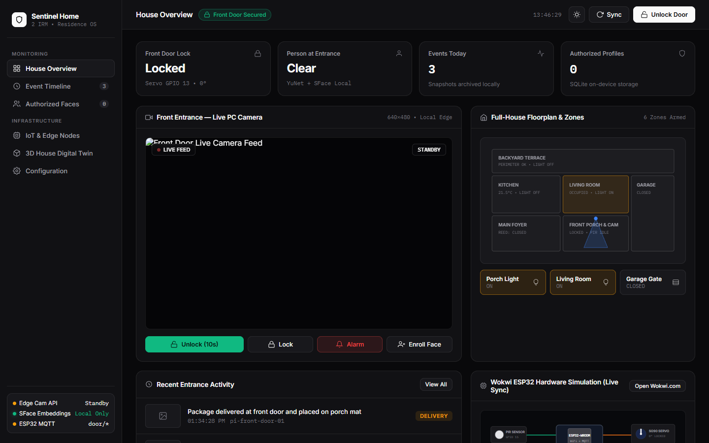
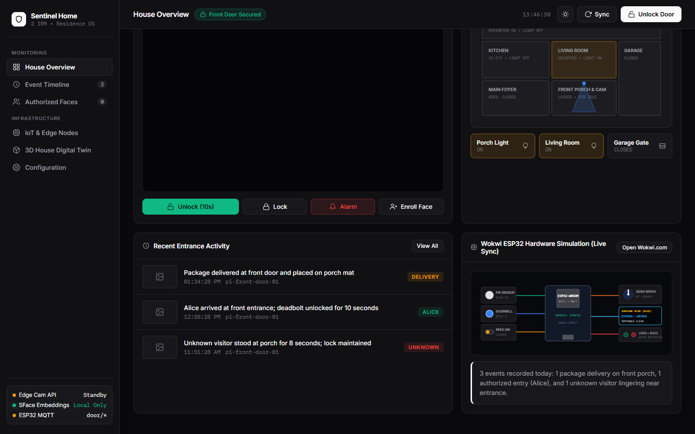
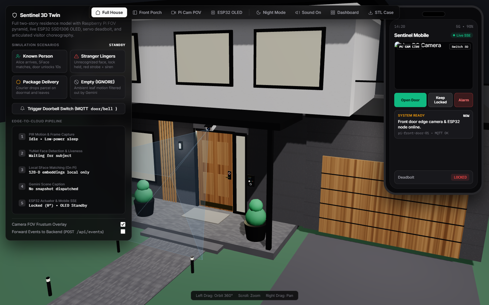
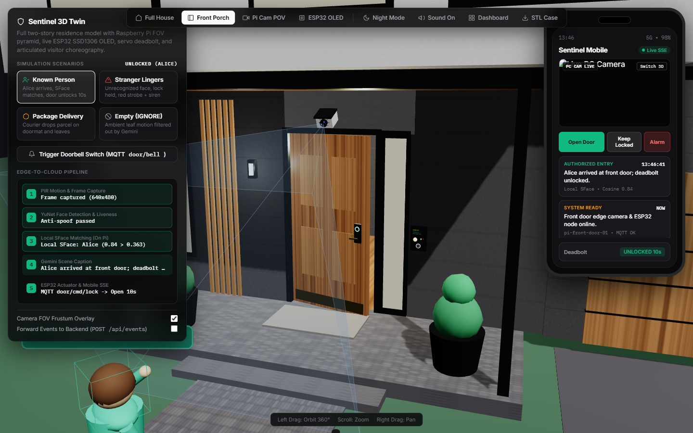
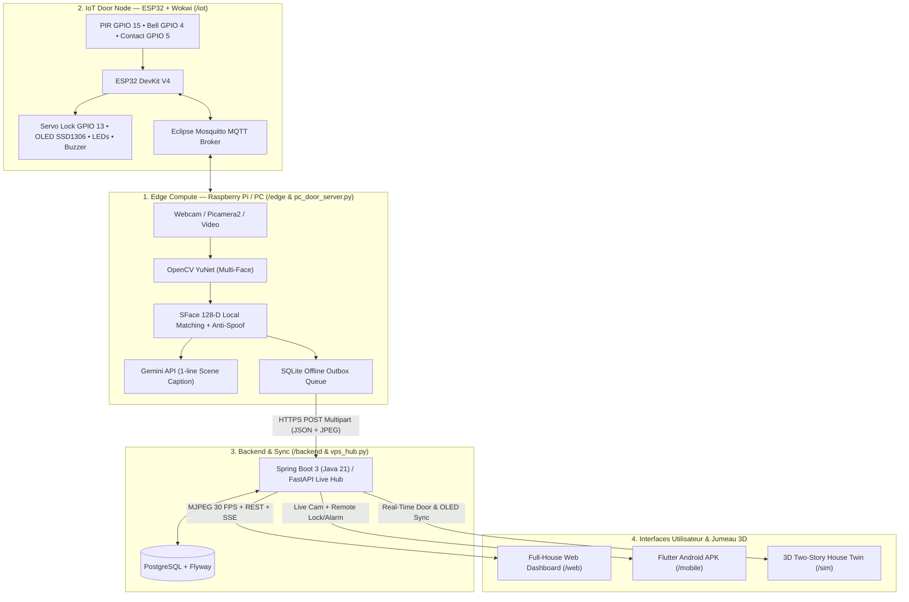

# Sentinel Home — Smart Door Camera & Cyber-Physical IoT Security System

> **Projet IoT, Systèmes Cyber-Physiques & IA (2 IRM)**  
> **Auteur :** Yassine Mezghanni — [github.com/yassine-dev2004/iot-project](https://github.com/yassine-dev2004/iot-project)

Un système complet de **caméra de porte intelligente et contrôle d'accès cyber-physique** combinant reconnaissance faciale locale (**OpenCV YuNet + SFace**, sans `dlib`), résumé d'événements par **Google Gemini**, nœud matériel **ESP32 + MQTT (simulé sur Wokwi)**, backend **Spring Boot 3 + PostgreSQL**, application mobile **Flutter (APK Android)**, **Dashboard Web Full-House**, et **Jumeau Numérique 3D Three.js** (avec boîtier imprimable 3D `.stl`).

---

## 1. Aperçu Visuel (Captures du Projet)

### Dashboard Web Full-House — Caméra PC Live 30 FPS & Plan Architectural Interactif


### Simulateur Matériel Wokwi ESP32 Intégré & Historique des Événements


### Jumeau Numérique 3D — Maison Contemporaine 2 Étages, Cône FOV & Smartphone Live


### Scénario Personne Connue — Reconnaissance SFace & Ouverture Motorisée de la Porte (80°)


---

## 2. Architecture Globale



---

## 2. Règles Strictes de Confidentialité (Privacy-by-Design)

- **Reconnaissance 100% locale** : Les vecteurs d'embeddings faciaux 128-D (**SFace**) restent strictement stockés localement dans SQLite sur le Raspberry Pi / PC et ne sont **jamais** transmis au backend ni à Gemini.
- **Légendage Gemini sécurisé** : Gemini reçoit uniquement un instantané ponctuel lors d'un événement avec pour instruction formelle de ne jamais identifier une personne par son visage (l'identité provient uniquement de SFace local).
- **Anti-spoofing & Liveness** : Vérification de micro-mouvement multi-trames + lissage temporel sur 2 trames consécutives pour empêcher le déverrouillage avec une photo.
- **Zéro secret versionné** : Tous les tokens/clés API passent par `.env` (modèle fourni dans `edge/.env.example`), et les bases SQLite / snapshots personnels sont exclus via `.gitignore`.

---

## 3. Explication Complète de Chaque Module

### `/edge` — Pipeline Vision IA Edge (Raspberry Pi 4/5 ou PC)
- **`camera.py`** : Abstraction `CameraSource` supportant `USBWebcamSource`, `Picamera2Source`, `VideoFileSource` (boucle vidéo pour tests sans matériel) et `ImageFileSource` (photos réelles `.jpg`/`.png`).
- **`faces.py`** : Détection multi-visages **YuNet**, reconnaissance cosinus **SFace** 128-D, correction automatique basse lumière **CLAHE**, moyennage L2 multi-angles lors du ré-enrôlement, lissage temporel et contrôle **Liveness anti-spoof**.
- **`llm.py`** : Intégration officielle `google-genai` (modèle configurable via `GEMINI_MODEL`), avec repli automatique propre si la clé API est absente et gestion du filtre `IGNORE`.
- **`storage.py` & `notifier.py`** : Stockage SQLite local + file d'attente hors-ligne **Outbox** avec retry automatique + envoi multipart `POST /api/events` + alertes photo optionnelles **Telegram**.
- **`mqtt_client.py`** : Pont MQTT reliant le Pi à l'ESP32 (`door/motion`, `door/bell`, `door/cmd/lock`, `door/cmd/led`, `door/display`).
- **`main.py`** : CLI complète (`enroll`, `enroll-dir`, `run`, `summary`) + déploiement Linux (`smart-door.service`, `install.sh`).
- **`tests/test_edge.py`** : Suite de tests unitaires `pytest` (enrôlement, cooldown, file hors-ligne, gestion `IGNORE`, source vidéo).

### `pc_door_server.py` — Serveur Live Caméra PC 30 FPS & Machine à États Porte
- Capture webcam dédiée à **30 FPS** découplée du thread IA (`ai_recognition_worker`) pour un flux vidéo **MJPEG** fluide (`/api/camera/stream`) sans saccades.
- **Machine à états intelligente** :
  - **Personne reconnue** (2 trames confirmées) $\rightarrow$ déverrouillage automatique `10 s` avec barre de compte à rebours + cooldown de ré-entrée `15 s` (réarmé si la personne quitte le champ `> 3 s`).
  - **Inconnu rôdant (`> 4 s`)** $\rightarrow$ porte maintenue verrouillée + alarme sécurité + capture snapshot.
  - **Priorité Téléphone / Web** : contrôle instantané via `/api/door/unlock`, `/lock`, `/alarm` et enrôlement en direct `/api/people/enroll-live`.

### `/iot` — Nœud Porte ESP32 + MQTT + Simulation Wokwi
- **`src/main.cpp`** (Arduino / PlatformIO) : Lecture anti-rebond du **capteur PIR (`GPIO 15`)**, **sonnette (`GPIO 4`)**, **contact magnétique porte (`GPIO 5`)** ; pilotage du **servomoteur serrure (`GPIO 13`, `90°` pendant `10 s`)**, **LED verte (`GPIO 18`)**, **LED rouge (`GPIO 19`)**, **buzzer (`GPIO 23`)** et **écran OLED SSD1306 I2C (`SDA 21 / SCL 22`)**.
- **`wokwi/diagram.json` & `wokwi.toml`** : Schéma électronique complet prêt à lancer sur [Wokwi](https://wokwi.com/projects/new/esp32) via `Wokwi-GUEST`.
- **`esp32_simulator.py`** : Simulateur Python MQTT permettant de tester toute la boucle sans Wokwi ni matériel.
- Voir [iot/README.md](iot/README.md) pour le tableau complet de câblage et des topics MQTT.

### `/backend` — Backend Spring Boot 3 (Java 21) + PostgreSQL
- Entités JPA `Event` & `Device`, migrations **Flyway** (`V1__init_schema.sql`), documentation **OpenAPI/Swagger**.
- Endpoints REST & temps réel : `POST /api/events` (multipart + `X-Device-Api-Key`), `GET /api/events` (pagination + filtres), `GET /api/events/{id}/image`, `GET /api/events/stream` (**SSE**), `GET /api/summary/today` (résumé journalier en cache), `DELETE /api/events/{id}`.
- Tâche planifiée `@Scheduled` de purge automatique des anciens snapshots + `Dockerfile` multi-stage + `docker-compose.yml` (PostgreSQL + Eclipse Mosquitto + Backend).

### `/mobile` — Application Mobile Flutter (Android APK)
- Application 3 onglets (*Caméra & Porte*, *Historique & Photos*, *Personnes autorisées*) avec thème sombre pro :
  - Vue en direct de la caméra PC avec identification de la personne devant la porte.
  - Boutons de contrôle à distance : **Ouvrir la porte (10 s)**, **Verrouiller**, **Alarme**, et **Enregistrer la personne devant la caméra**.
  - Écran détail avec snapshot réel + paramètres d'URL serveur (Wi-Fi local, Cloudflare HTTPS ou VPS).
  - Tests de widgets (`mobile/test/widget_test.dart`).

### `/web` — Dashboard Web Full-House (`web/index.html`)
- Interface professionnelle *Matte Obsidian / Light* (*Inter* + *IBM Plex Mono*, icônes SVG fines, zéro emoji) :
  - Flux vidéo **30 FPS MJPEG** de la porte d'entrée + contrôles *Unlock / Lock / Alarm / Enroll Face*.
  - **Plan architectural interactif de toute la maison** (6 zones : Porche, Hall, Salon, Cuisine, Garage, Jardin) synchronisé en direct avec la serrure.
  - **Simulateur matériel Wokwi ESP32 intégré** : bras du servo SG90 animé (`0° ↔ 90°`), écran OLED SSD1306 temps réel, LEDs et capteurs PIR / Sonnette / Contact cliquables.
  - Timeline filtrable avec lightbox haute résolution, gestion des visages autorisés (webcam ou upload photo) et résumé quotidien Gemini.

### `/sim` — Jumeau Numérique 3D Maison Complète & Boîtier Imprimable STL
- **`sim/index.html`** : Scène **Three.js** d'une maison contemporaine à 2 étages avec garage, façade béton/cèdre, porche, porte en chêne motorisée sur charnières (`0° ↔ 80°`), caméra Pi avec **pyramide FOV + plan laser**, station murale **ESP32 OLED 3D en direct**, mode **Jour/Nuit**, 4 angles de caméra, personnages 3D articulés (*Alice*, *Inconnu*, *Livreur avec colis*) et smartphone simulé affichant le vrai flux webcam PC.
- **`sim/enclosure/`** : Script paramétrique CadQuery (`generate_case.py`) + fichier prêt à imprimer `smart_door_case.stl` + guide d'impression (`README.md`).

---

## 4. Structure du Dépôt

```text
├── edge/                  # Pipeline Edge Python (YuNet, SFace, Gemini, SQLite Outbox, MQTT, tests)
├── iot/                   # Firmware ESP32 PlatformIO, schéma Wokwi, Mosquitto & simulateur Python
├── backend/               # Backend Spring Boot 3 (Java 21), Flyway, PostgreSQL, SSE, Dockerfile
├── mobile/                # Application Mobile Flutter (Android) + widget tests
├── web/                   # Full-House Security Web Dashboard + Wokwi ESP32 interactif
├── sim/                   # Jumeau Numérique 3D Three.js + boîtier 3D STL (/sim/enclosure)
├── docs/                  # Protocole de test, guide VPS et Roadmap
├── pc_door_server.py      # Serveur unifié 30 FPS Webcam PC + API Mobile/Web/3D
├── vps_hub.py             # Hub relais cloud léger pour déploiement VPS
├── pc_camera_agent.py     # Agent PC synchronisant la webcam locale vers le VPS
├── seed_events.py         # Générateur de faux événements et snapshots pour démo sans Pi
├── docker-compose.yml     # Stack complète : PostgreSQL + Mosquitto + Spring Boot Backend
└── lancer_tunnel_public_sans_vps.bat  # Lanceur 1-clic PC + Cloudflare Quick Tunnel HTTPS
```

---

## 5. Variables d'Environnement (`edge/.env.example`)

| Variable | Valeur par défaut | Rôle |
|---|---|---|
| `DEVICE_ID` | `pi-front-door-01` | Identifiant de la caméra de porte |
| `DEVICE_API_KEY` | `sk_device_...` | Clé d'authentification `X-Device-Api-Key` vers le backend |
| `BACKEND_URL` | `http://localhost:8080/api/events` | Endpoint d'ingestion multipart |
| `GEMINI_API_KEY` | *(vide)* | Clé Google Gemini (repli automatique sans clé) |
| `GEMINI_MODEL` | `gemini-2.5-flash` | Modèle Gemini utilisé pour les légendes |
| `FACE_RECOG_COSINE_THRESH` | `0.38` | Seuil de reconnaissance cosinus SFace |
| `EVENT_COOLDOWN_SECONDS` | `30.0` | Délai anti-spam entre deux captures |
| `TELEGRAM_BOT_TOKEN` / `CHAT_ID` | *(vide)* | Notifications push photo optionnelles sur Telegram |

---

## 6. Démarrage Rapide (< 15 minutes)

### A. Démo Complète Immédiate (Webcam PC + Web + 3D + Mobile via Cloudflare HTTPS)
1. Installez les dépendances Python et téléchargez les modèles ONNX YuNet + SFace dans `edge/models/` :
   ```bash
   pip install -r requirements.txt
   ```
2. Lancez le serveur unifié 30 FPS :
   ```bash
   python -m uvicorn pc_door_server:app --host 0.0.0.0 --port 8085
   ```
   - Dashboard Web : `http://localhost:8085/web/index.html`
   - Modèle 3D Maison : `http://localhost:8085/sim/index.html`
   - Pour un accès **4G/5G depuis votre téléphone sans VPS**, double-cliquez sur `lancer_tunnel_public_sans_vps.bat` (Cloudflare Quick Tunnel).

### B. CLI Edge (Raspberry Pi ou Fichier Vidéo sans matériel)
```bash
# Enrôler toutes les photos réelles placées dans edge/known_people/ (ex: Yassine.jpg)
python -m edge.main enroll-dir --dir edge/known_people

# Ou enrôler depuis la webcam (0) ou une vidéo
python -m edge.main enroll --name "Yassine" --source 0

# Lancer la surveillance en continu (avec ou sans --mqtt)
python -m edge.main run --source video.mp4

# Vérifier les profils locaux et la file d'attente Outbox
python -m edge.main summary
```

### C. Backend Spring Boot + PostgreSQL + Mosquitto (Docker)
```bash
docker compose up -d
python seed_events.py
```

### D. Compiler l'APK Android (Flutter)
```bash
cd mobile
flutter pub get
flutter test
flutter build apk --release
# APK généré : mobile/build/app/outputs/flutter-apk/app-release.apk
```

### E. Lancer les Tests Unitaires Edge
```bash
python -m pytest edge/tests -v
```

---

## 7. Dépannage (Troubleshooting)

- **Caméra non détectée (`index 0`)** : Fermez toute autre application utilisant la webcam (Zoom, Teams, navigateur) ou utilisez `--source video.mp4` pour tester sans matériel.
- **Précision de reconnaissance faible** : Ré-enrôlez la même personne une seconde fois sous un angle ou un éclairage différent (`Enroll Face` avec le même nom) : le système fusionne automatiquement les vecteurs 128-D (moyennage L2).
- **Clé Gemini absente ou quota dépassé** : Le pipeline bascule automatiquement sur des légendes locales claires sans interrompre la détection ni l'ouverture de porte.
- **Port `8080` déjà occupé sur Windows** : `pc_door_server.py` utilise le port `8085` par défaut pour éviter tout conflit avec d'autres services locaux.
